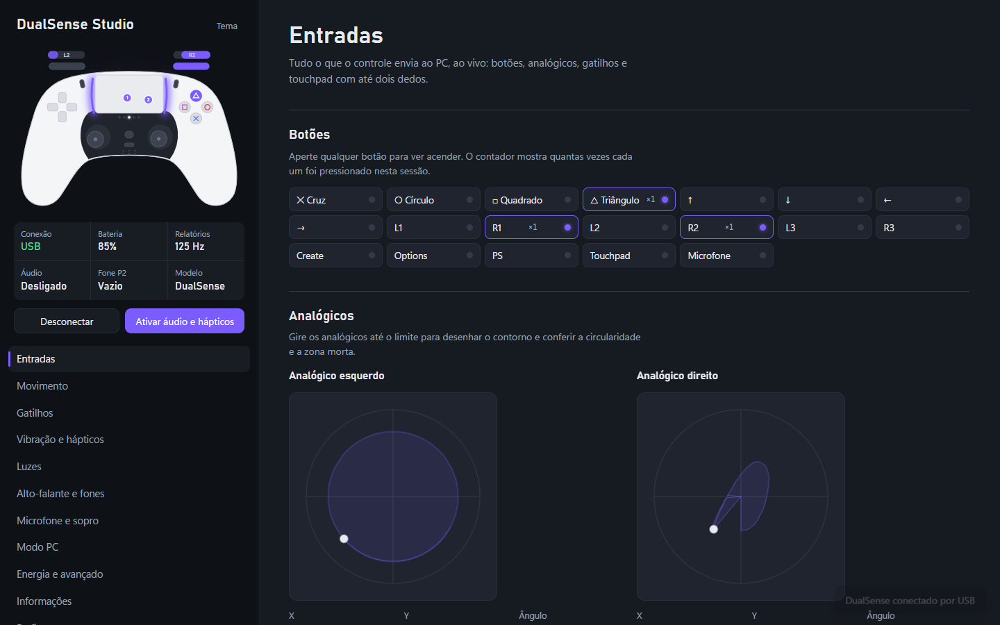
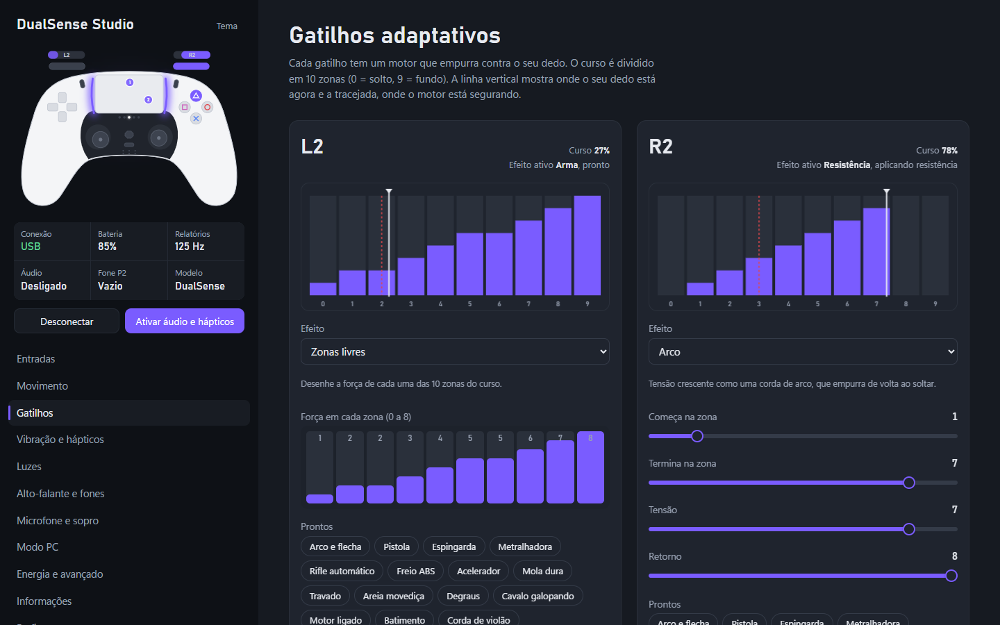
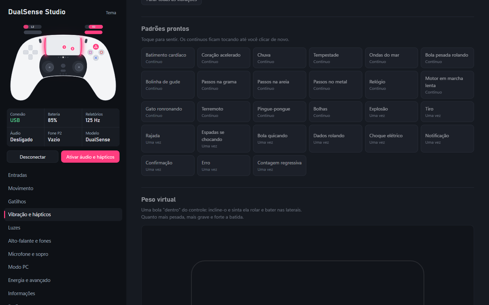
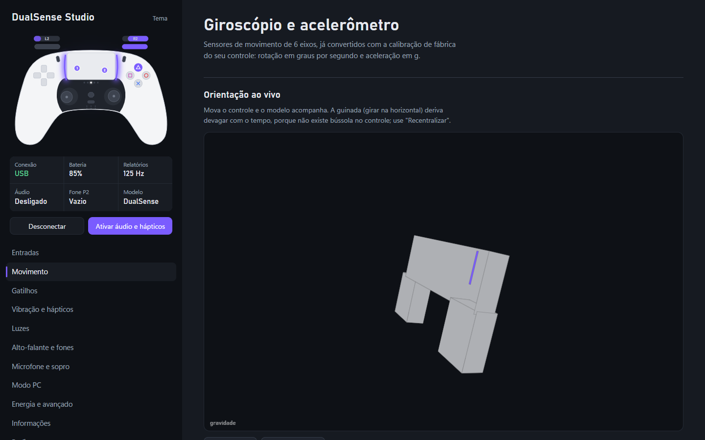
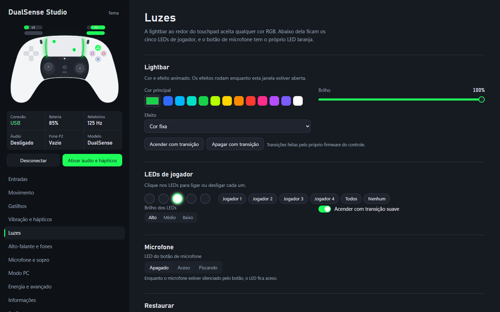
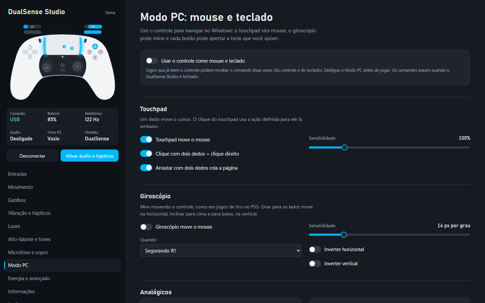
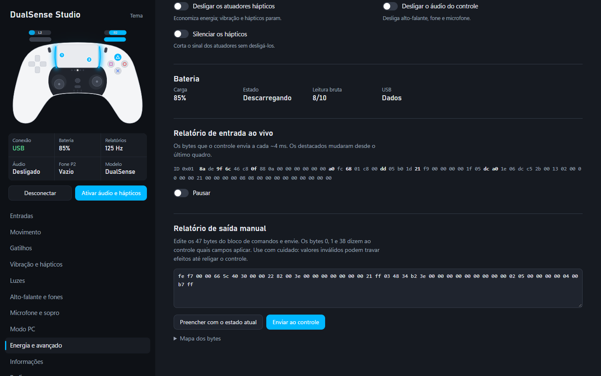
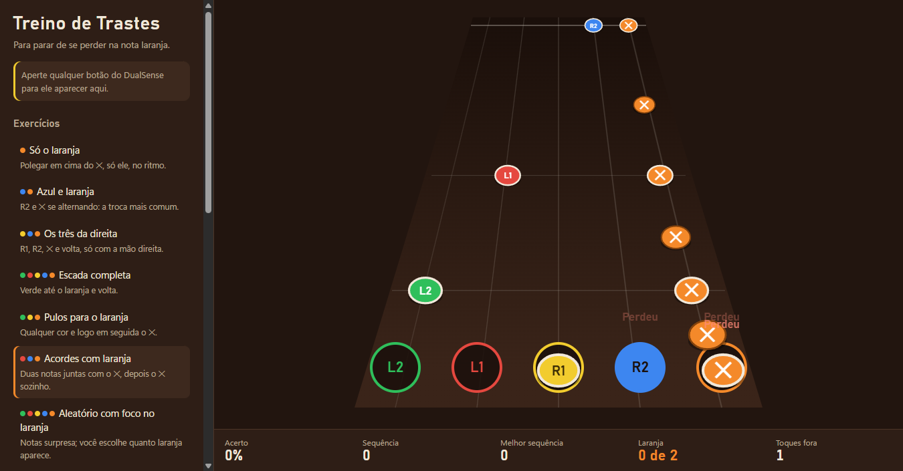

<div align="center">

# DualSense Studio

**Configure, teste e use todas as funções do controle DualSense (PS5) no Windows, pelo cabo USB ou pelo Bluetooth.**

Gatilhos adaptativos · hápticos HD · peso virtual · lightbar · alto-falante · microfone e sopro · giroscópio · touchpad · modo mouse e teclado




</div>

---

## Por que existe

O DualSense é o controle mais completo que já existiu, mas no PC quase tudo fica escondido: os gatilhos não resistem, os atuadores hápticos ficam parados, o alto-falante e o microfone não fazem nada. O **DualSense Studio** conversa diretamente com o controle e libera cada recurso, com uma interface feita para ver e sentir cada ajuste na hora.

- **Nada para instalar além do Node.js.** A interface roda no Chrome ou no Edge e fala com o controle pela WebHID.
- **O controle desenhado ao vivo.** Botões, analógicos, gatilhos, dedos no touchpad e a cor da lightbar aparecem em tempo real, e a cor de destaque da interface segue a lightbar.
- **Cabo ou Bluetooth.** Hápticos HD, alto-falante e microfone funcionam nos dois.

## O que dá para fazer

| | |
|---|---|
| **Entradas** | Todos os botões (inclusive os extras do DualSense Edge), analógicos com teste de circularidade, gatilhos analógicos de 0 a 255 e touchpad com dois dedos. |
| **Movimento** | Giroscópio e acelerômetro com a calibração de fábrica do seu controle, orientação 3D ao vivo, gráfico e ajuste de deriva. |
| **Gatilhos adaptativos** | Resistência, rampa, zonas desenhadas à mão, arma, arco, galope, vibração, vibração por zonas, máquina, modos antigos do firmware e bytes manuais. 16 prontos, como arco e flecha, pistola e freio ABS. |
| **Vibração e hápticos** | 27 padrões HD, **peso virtual** (uma bola rola dentro do controle quando você inclina), texturas no touchpad, gerador por atuador, som virando vibração (arquivo, áudio do PC ou microfone) e os motores clássicos. |
| **Luzes** | Lightbar RGB com 13 efeitos (respirar, arco-íris, segue os gatilhos, a inclinação, o touchpad ou o som), LEDs de jogador e LED do microfone. |
| **Alto-falante e fones** | Rota de saída, volumes, reforço do amplificador, sons de teste e arquivos tocando no próprio controle. |
| **Microfone e sopro** | Nível e espectro, cancelamento de eco, redução de ruído, gravação, retorno nos fones e **detecção de sopro** com cata-vento. |
| **Modo PC** | Touchpad como mouse, mira por giroscópio, analógicos como mouse, rolagem ou WASD, e qualquer botão virando tecla, clique ou atalho. |
| **Energia e avançado** | Desligar partes do controle para poupar bateria, relatório de entrada ao vivo e editor do relatório de saída. |
| **Perfis** | Salvar, trocar, exportar e importar a configuração inteira. |

## Telas

<table>
  <tr>
    <td width="50%"><br><sub><b>Gatilhos adaptativos.</b> Força por zona, posição do dedo e o ponto onde o motor está segurando, ao vivo.</sub></td>
    <td width="50%"><br><sub><b>Hápticos HD.</b> Batimento, chuva, passos em superfícies diferentes, explosões e mais.</sub></td>
  </tr>
  <tr>
    <td><br><sub><b>Movimento.</b> O modelo acompanha o controle em tempo real.</sub></td>
    <td><br><sub><b>Luzes.</b> Cor, efeitos, brilho e LEDs de jogador.</sub></td>
  </tr>
  <tr>
    <td><br><sub><b>Modo PC.</b> O controle vira mouse e teclado no Windows.</sub></td>
    <td><br><sub><b>Avançado.</b> Os bytes que o controle envia, destacando o que mudou.</sub></td>
  </tr>
</table>

## Bônus: Treino de Trastes



Um treinador de ritmo para jogos de guitarra no esquema clássico de controle (**L2, L1, R1, R2 e ✕**), criado para quem se perde na nota laranja. Cada nota mostra o botão que deve ser apertado, e há oito exercícios (do "só o laranja" até acordes e aleatório), teste de reflexo e um resumo que diz se você está adiantado ou atrasado em cada cor.

Abra o arquivo `Treino de Guitarra.html` no Chrome ou no Edge e aperte um botão do controle. Ele não precisa do servidor e usa a API de controles do navegador, então funciona ao mesmo tempo que um jogo no navegador.

## Como usar

**Requisitos:** Windows 10 ou 11, [Node.js](https://nodejs.org) 18 ou mais novo, Google Chrome ou Microsoft Edge e um DualSense ou DualSense Edge.

```bash
git clone https://github.com/gabrielsoares97/dualsense-studio.git
```

1. Conecte o controle pelo cabo USB ou pelo Bluetooth.
2. Dê dois cliques em **`Iniciar DualSense Studio.bat`**. Uma janela do navegador abre como aplicativo.
3. Clique em **Conectar controle** e escolha *DualSense Wireless Controller*.
4. Clique em **Ativar áudio e hápticos**.

A janela preta do `.bat` é o servidor local. Deixe aberta enquanto usa e feche para encerrar.

### Cabo ou Bluetooth

| | Cabo USB | Bluetooth |
|---|:---:|:---:|
| Botões, sensores, touchpad, gatilhos, luzes e vibração clássica | ✔ | ✔ |
| Hápticos HD | ✔ | ✔ |
| Alto-falante e fone P2 | ✔ | ✔ (com ~0,1 s de atraso) |
| Microfone | ✔ | ✔ |

**Não use as duas conexões ao mesmo tempo.** Com o Bluetooth e o cabo ligados juntos, o firmware do controle silencia o áudio pelo cabo. O programa detecta isso e mostra o botão **Usar só o cabo**, que derruba apenas o link sem fio (o pareamento continua salvo).

## Problemas comuns

- **Hápticos ou alto-falante mudos pelo cabo:** quase sempre é a conexão dupla acima. Se não for, confira o volume que o Windows aplica ao dispositivo *Alto-falantes (DualSense Wireless Controller)*. Em 0% os hápticos ficam mudos, e o programa tem um botão para ajustar.
- **Um jogo no navegador não reconhece o controle pelo Bluetooth depois de usar o DualSense Studio:** ao ler os sensores, o controle entra num modo que a API de controles do navegador não entende. Desligue e ligue o controle (segure PS por 10 segundos e aperte PS de novo).
- **Jogos e Steam:** enquanto um jogo controla o DualSense, ele pode sobrescrever luzes e gatilhos. Feche o jogo para testar no programa, e desligue o Modo PC antes de jogar.

## Como funciona

```
app/                 interface (HTML, CSS e JavaScript puros, sem build)
  js/protocol.js     relatórios HID do DualSense: entrada, saída, calibração e CRC do Bluetooth
  js/triggers.js     codificação dos efeitos dos gatilhos adaptativos
  js/audio.js        hápticos e alto-falante pela placa de som USB de 4 canais
  js/bt-audio.js     hápticos (0x32), alto-falante em Opus (0x35) e microfone pelo Bluetooth
server.js            servidor local em 127.0.0.1, perfis e ponte para o Windows
tools/               scripts do Windows: mouse e teclado, volume e link Bluetooth
Treino de Guitarra.html
```

- **USB:** o controle aparece como uma placa de som de 4 canais. Os canais 1 e 2 vão para o alto-falante ou o fone, e os canais 3 e 4 movem os atuadores hápticos.
- **Bluetooth:** não existe placa de som. O áudio do programa é capturado por um AudioWorklet a cada 10,67 ms e enviado dentro de relatórios HID: hápticos em 8 bits a 3 kHz e alto-falante comprimido em Opus pela WebCodecs. O microfone volta em Opus no meio dos relatórios de entrada.
- **Segurança:** o servidor só aceita conexões da própria máquina, confere a origem de cada pedido e protege o Modo PC com um token.

O formato do áudio pelo Bluetooth se baseia no trabalho aberto dos projetos [SAxense](https://github.com/egormanga/SAxense) e [PadForge](https://github.com/hifihedgehog/PadForge), e os efeitos dos gatilhos na engenharia reversa da comunidade do DualSense.

## Licença

[MIT](LICENSE) © 2026 Gabriel Soares

<sub>Projeto independente, sem ligação com a Sony Interactive Entertainment. DualSense e PlayStation são marcas da Sony.</sub>
